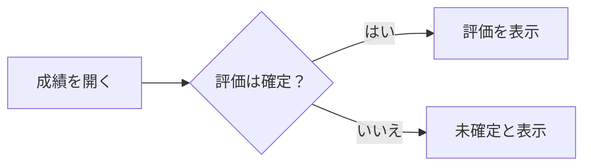

# システム設計Ⅰ
## 次の見出し

- 要件定義
- 外部設計

この授業は特に **ここ**が重要です

> ここのサイトから調べました

[いわきコンカレ] (https://www.iwaki-cc.ac.jp)

| 項目名 | 型 | 桁数 | 必須 |
|---|---|---:|:---:|
| 学籍番号 | 文字 | 5 | 〇 |
| 科目名 | 文字 | 60 | 〇 |
| 素点 | 数値 | 3 | |
 
```sql
SELECT * FROM　履修
WHERE 評価 IS NULL;
```
- [x] 機能一覧を作る
- [ ] 非機能要件を書く
- [ ] レビューを受ける




